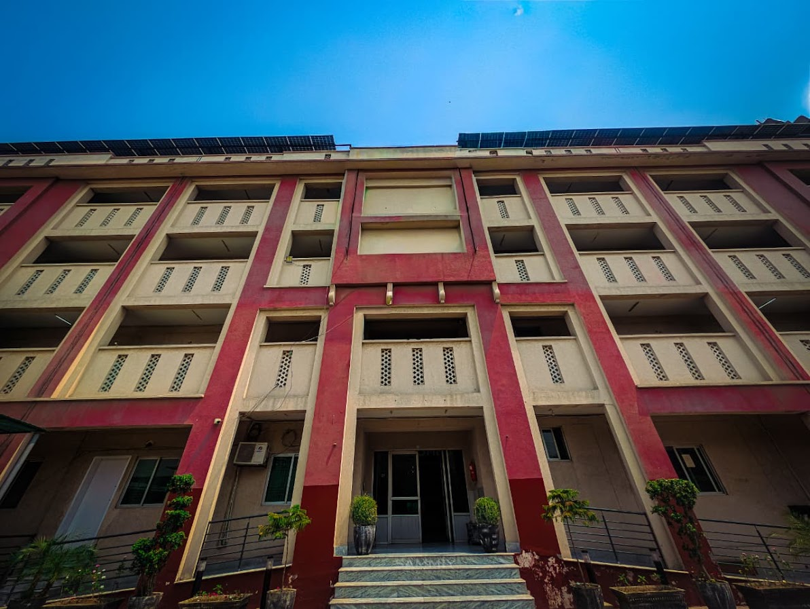
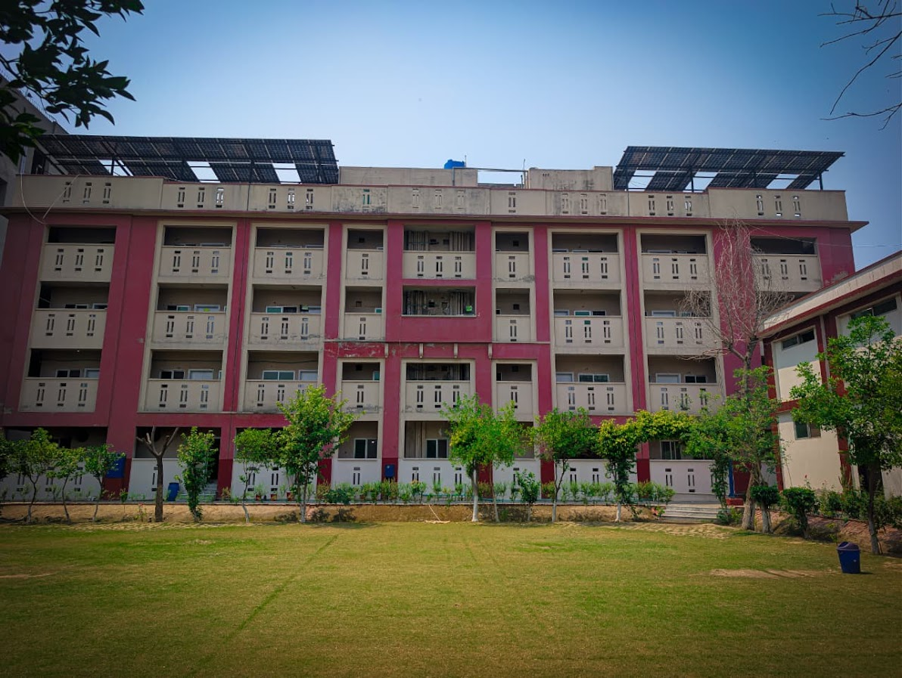
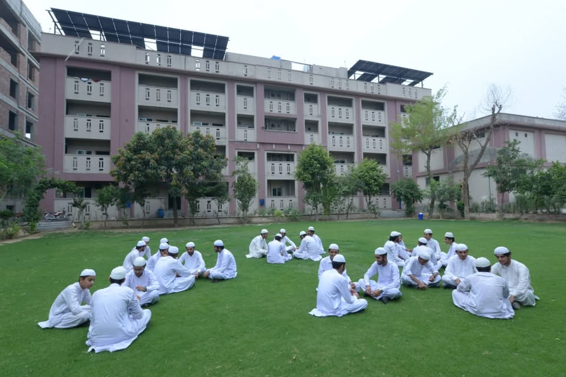
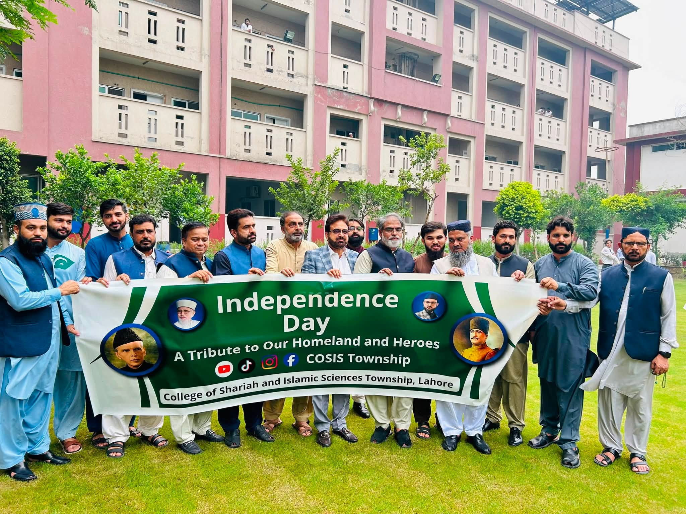
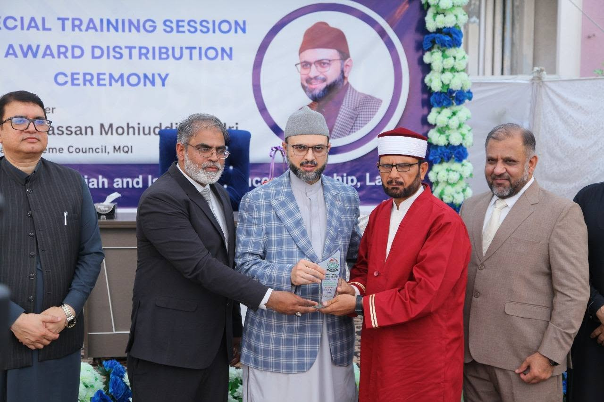
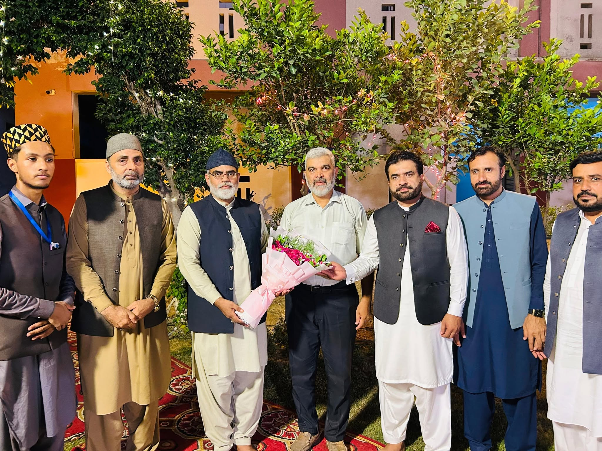
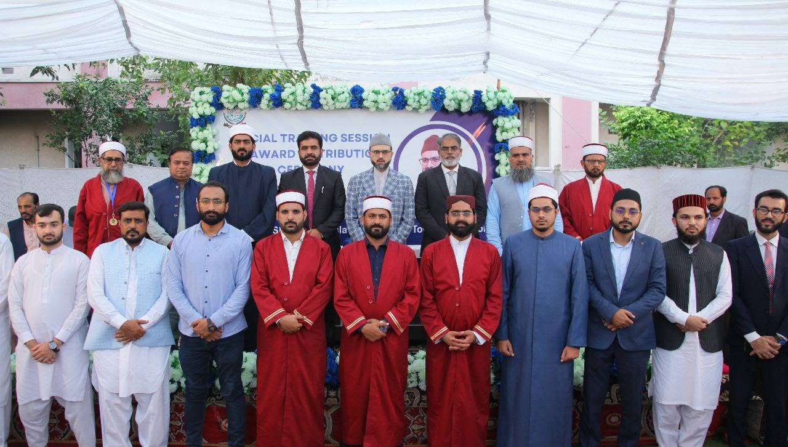
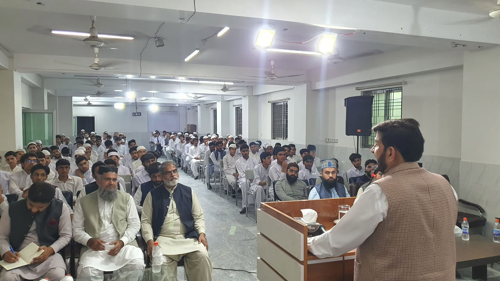

<!DOCTYPE html>
<html lang="en">
<head>
<meta charset="UTF-8">
<meta name="viewport" content="width=device-width, initial-scale=1.0">

<meta name="description"
content="COSIS Township Lahore - College of Sharia and Islamic Sciences">

<title>COSIS Township Lahore | College of Shariah & Islamic Sciences</title>

<link rel="preconnect" href="https://fonts.googleapis.com">
<link rel="preconnect" href="https://fonts.gstatic.com" crossorigin>

<link href="https://fonts.googleapis.com/css2?family=Amiri:wght@400;700&family=Inter:wght@300;400;500;600;700;800&display=swap"
rel="stylesheet">

</head>

<body>

<!-- =======================================================
     NAVIGATION
======================================================= -->

<nav>

    

        

            
        

        

            <strong>COSIS TOWNSHIP</strong>

            
                College of Shariah & Islamic Sciences
            
        

    

    

        ☰
    

    <ul id="navMenu">

        <li>
            <a href="#home">Home</a>
        </li>

        <li>
            <a href="#about">About</a>
        </li>

        <li>
            <a href="#programs">Programs</a>
        </li>

        <li>
            <a href="#events">Events</a>
        </li>

        <li>
            <a href="#contact">Contact</a>
        </li>

        <li>
            <a class="admission-btn"
               href="admission .html">
                Admissions
            </a>
        </li>

    </ul>

</nav>

<!-- =======================================================
     HERO
======================================================= -->

<section class="hero" id="home">

    

        

            College of Shariah & Islamic Sciences
        

        <h1>
            
                Knowledge. 
                Character. 
                Leadership.
            
        </h1>

        

            Welcome to COSIS Township Lahore — a center
            dedicated to learning, Islamic scholarship,
            character development and the preparation of
            students for meaningful service to society.
        

        

            <a href="#programs" class="btn btn-primary">
                Explore Programs
            </a>

            <a href="#contact" class="btn btn-outline">
                Contact Us
            </a>

        

    

</section>

<!-- =======================================================
     QUICK INFORMATION
======================================================= -->

    

        

            🎓
        

        

            <h4>Quality Education</h4>

            

                Islamic and academic learning
            

        

    

    

        

            📚
        

        

            <h4>Islamic Scholarship</h4>

            

                Knowledge rooted in Islamic tradition
            

        

    

    

        

            🌱
        

        

            <h4>Student Development</h4>

            

                Character, leadership and growth
            

        

    

<!-- =======================================================
     ABOUT
======================================================= -->

<section id="about">

    

        <small>
            About COSIS
        </small>

        <h2>
            A Center of Learning
        </h2>

        

            Developing knowledgeable, principled and
            capable individuals through education and training.
        

    

    

        

            Welcome to College of shariyah and islamic Sciences Township Lahore
        

    

    <!-- CAROUSEL -->

    

        

            

            

            

            

            

            

            

            
            
            

        

        <button class="prev"
                onclick="previousSlide()"
                aria-label="Previous slide">
            ❮
        </button>

        <button class="next"
                onclick="nextSlide()"
                aria-label="Next slide">
            ❯
        </button>

        

    

    

        <h3>
            Education With Purpose
        </h3>

        

            The College of Sharia and Islamic Sciences
            (COSIS) is an institution associated with
            Minhaj University Lahore and has a long
            history of Islamic and academic education.
        

        

            The institution seeks to combine Islamic
            scholarship with contemporary educational
            approaches and develop students intellectually,
            spiritually and personally.
        

        <ul class="check-list">

            <li>
                Islamic Studies and Shariah
            </li>

            <li>
                Qur'an and Islamic learning
            </li>

            <li>
                Character and moral development
            </li>

            <li>
                Academic and intellectual growth
            </li>

            <li>
                Leadership and community service
            </li>

        </ul>

        <a href="http://www.cosis.edu.pk/english/index.html"
           target="_blank"
           class="btn btn-primary">

            Visit Official Website

        </a>

    

</section>

<!-- =======================================================
     PROGRAMS
======================================================= -->

<section class="programs" id="programs">

    

        <small>
            Education
        </small>

        <h2>
            Programs & Learning
        </h2>

        

            Explore the areas of learning and training
            offered through COSIS.
        

    

    

        

            

                PROGRAM 01
            

            <h3>
                Shariah & Islamic Sciences
            </h3>

            

                Study Islamic knowledge, ics and
                related areas of Islamic sciences.
            

            <a href="#contact" class="program-link">
                Learn More →
            </a>

        

        

            

                PROGRAM 02
            

            <h3>
                Islamic Training Courses
            </h3>

            

                Arabic course and english language
                course and many computer courses
            

            <a href="#contact" class="program-link">
                Learn More →
            </a>

        

        

            

                PROGRAM 03
            

            <h3>
                Qur'anic Learning
            </h3>

            

                Learning opportunities covering Qur'anic
                understanding, translation, recitation
                and related subjects.
            

            <a href="#contact" class="program-link">
                Learn More →
            </a>

        

        

            

                PROGRAM 04
            

            <h3>
                Islamic Ethics
            </h3>

            

                Developing character, manners and responsible
                conduct through Islamic teachings.
            

            <a href="#contact" class="program-link">
                Learn More →
            </a>

        

        

            

                PROGRAM 05
            

            <h3>
                Research & Scholarship
            </h3>

            

                Encouraging academic thinking, research,
                intellectual development and scholarly work.
            

            <a href="#contact" class="program-link">
                Learn More →
            </a>

        

        

            

                PROGRAM 06
            

            <h3>
                Student Development
            </h3>

            

                Activities and lectures supporting students'
                personal, intellectual and leadership development.
            

            <a href="#contact" class="program-link">
                Learn More →
            </a>

        

    

</section>

<!-- =======================================================
     QUOTE
======================================================= -->

<section class="quote">

    

        وَقُلْ رَبِّ زِدْنِي عِلْمًا
    

    

        “And say: My Lord, increase me in knowledge.”
    

</section>

<!-- =======================================================
     WHY COSIS
======================================================= -->

<section class="features-section">

    

        <small>
            Why COSIS
        </small>

        <h2>
            Learning Beyond Books
        </h2>

        

            Building knowledge, character and confidence
            for meaningful service to society.
        

    

    

        

            

                📖
            

            <h3>
                Islamic Learning
            </h3>

            

                Knowledge rooted in Islamic tradition.
            

        

        

            

                🎓
            

            <h3>
                Academic Growth
            </h3>

            

                Encouraging intellectual development.
            

        

        

            

                🌱
            

            <h3>
                Character Building
            </h3>

            

                Developing responsible and principled individuals.
            

        

        

            

                ⭐
            

            <h3>
                Leadership
            </h3>

            

                Preparing students for meaningful service.
            

        

    

</section>

<!-- =======================================================
     EVENTS
======================================================= -->

<section class="events" id="events">

    

        <small>
            Campus Life
        </small>

        <h2>
            News & Events
        </h2>

        

            Keep students and visitors informed about
            educational activities and campus events.
        

    

    

        

            

                <strong>
                    01
                </strong>

                EVENT

            

            

                <h3>
                    Guest Lecture Series
                </h3>

                

                    Educational talks and sessions featuring
                    distinguished speakers and resource persons.
                

            

            

                EDUCATION
            

        

        

            

                <strong>
                    02
                </strong>

                EVENT

            

            

                <h3>
                    Student Training
                </h3>

                

                    Training activities focused on personal,
                    intellectual and spiritual development.
                

            

            

                TRAINING
            

        

        

            

                <strong>
                    03
                </strong>

                EVENT

            

            

                <h3>
                    Academic & Award Ceremonies
                </h3>

                

                    Celebrating student achievement and
                    academic excellence.
                

            

            

                CAMPUS
            

        

    

</section>

<!-- =======================================================
     ADMISSIONS CTA
======================================================= -->

<section id="admissions">

    

        

            <h2>
                Begin Your Educational Journey
            </h2>

            

                Contact COSIS for current admission,
                program and course information.
            

        

        <a href="#contact" class="btn btn-primary">
            Admission Inquiry
        </a>

    

</section>

<!-- =======================================================
     CONTACT
======================================================= -->

<section id="contact">

    

        <small>
            Contact
        </small>

        <h2>
            Get In Touch
        </h2>

        

            Have a question about admissions,
            programs or courses? Send us a message.
        

    

    

        

            <h3>
                Contact COSIS
            </h3>

            

                For the most current information regarding
                admissions, courses, schedules and official
                announcements, please verify details through
                the official COSIS website.
            

            

                

                    📍
                

                

                    <strong>
                        <a href="https://www.google.com/maps/place/College+of+Shariah+and+Islamic+Sciences/@31.4446346,74.3153251,18z"
                           target="_blank">
                            Location
                        </a>
                    </strong>

                    
                        Township, Lahore, Pakistan
                    

                

            

            

                

                    🌐
                

                

                    <strong>
                        <a href="http://www.cosis.edu.pk/english/index.html"
                           target="_blank">
                            Official Website
                        </a>
                    </strong>

                    
                        cosis Township.pk
                    

                

            

            

                

                    🎓
                

                

                    <strong>
                        <a href="https://www.facebook.com/cosistownship/"
                           target="_blank">
                            Institution
                        </a>
                    </strong>

                    
                        College of Shariah & Islamic Sciences
                    

                

            

        

        

            <form onsubmit="submitForm(event)">

                

                    <input
                        type="text"
                        id="name"
                        placeholder="Your Name"
                        required
                    >

                    <input
                        type="email"
                        id="email"
                        placeholder="Your Email"
                        required
                    >

                

                <select id="subject" required>

                    <option value="">
                        Select Inquiry
                    </option>

                    <option>
                        Admissions
                    </option>

                    <option>
                        Programs
                    </option>

                    <option>
                        Courses
                    </option>

                    <option>
                        General Information
                    </option>

                </select>

                <textarea
                    id="message"
                    placeholder="Write your message..."
                    required></textarea>

                <button type="submit"
                        class="btn btn-primary">
                    Send Inquiry →
                </button>

            </form>

        

    

</section>

<!-- =======================================================
     FAQ
======================================================= -->

<section class="faq-section">

    

        <small>
            Information
        </small>

        <h2>
            Frequently Asked Questions
        </h2>

        

            Find answers to common questions about COSIS.
        

    

    

        

            

                
                    What is COSIS?
                

                +

            

            

                

                    The College of Sharia and Islamic Sciences
                    (COSIS) is an institution associated with
                    Minhaj University Lahore and has a long
                    history of Islamic and academic education.
                

            

        

        

            

                
                    What programs are available?
                

                +

            

            

                

                    COSIS offers learning opportunities covering
                    Shariah and Islamic Sciences, Islamic training,
                    Qur'anic learning, ethics, research and
                    student development.
                

            

        

        

            

                
                    How can I contact COSIS?
                

                +

            

            

                

                    You can use the contact information and
                    official website provided on this page
                    for current information.
                

            

        

        

            

                
                    Where is COSIS located?
                

                +

            

            

                

                    COSIS is located in Township, Lahore, Pakistan.
                

            

        

    

</section>

<!-- =======================================================
     FOOTER
======================================================= -->

<footer>

    

        

            

                COSIS Township
            

            

                College of Shariah and Islamic Sciences.
                A center of Islamic learning, education
                and student development.
            

        

        

            <h3>
                Quick Links
            </h3>

            <a href="#home">
                Home
            </a>

            <a href="#about">
                About
            </a>

            <a href="#programs">
                Programs
            </a>

            <a href="#events">
                Events
            </a>

        

        

            <h3>
                Students
            </h3>

            <a href="#admissions">
                Admissions
            </a>

            <a href="#programs">
                Courses
            </a>

            <a href="https://www.instagram.com/cosis_township_/"
               target="_blank">
                Instagram
            </a>

        

        

            <h3>
                Official website
            </h3>

            <a href="https://www.cosis.pk/"
               target="_blank">
                COSIS Website
            </a>

            <a href="https://mul.edu.pk/"
               target="_blank">
                Minhaj University Lahore
            </a>

        

    

    

        © 2026 COSIS Township Lahore.
        Website concept created for educational/informational use.

    

</footer>

<button id="scrollTop"
        aria-label="Scroll to top">
    ↑
</button>

</body>
</html>
